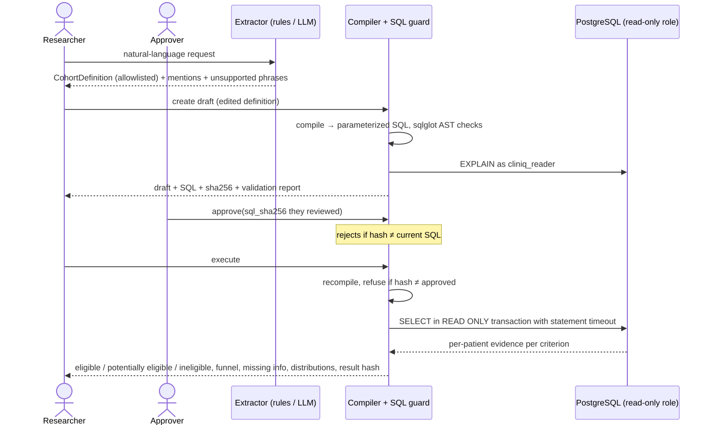

# CLINIQ — Technical design

Status: prototype (v0.1). Audience: engineers, data engineers and researchers evaluating or extending CLINIQ.

## 1. Goals and non-goals

**Goals**
- Turn heterogeneous clinical inputs into a validated, normalized, traceable analytical dataset.
- Let researchers express eligibility criteria in natural language, then review, approve and safely run them.
- Make every number explainable: for each patient and each criterion, show which record (or which missing data) drove the outcome.
- Measure the AI components against gold data, with version tracking and regression gates.
- Run fully locally, on synthetic data, with no paid services.

**Non-goals**
- Clinical validation, regulatory compliance, or use with real PHI.
- Full FHIR R4 or OMOP CDM conformance. CLINIQ is *FHIR-compatible input* and an *OMOP-inspired model*, and §3 lists exactly what is implemented.
- Being a general-purpose chatbot.

## 2. Components

| Component | Module | Responsibility |
|---|---|---|
| Synthetic generator | `cliniq.synth.generator` | Seeded patients, a clinically plausible story (disease → histology → driver mutation → tests → treatments → labs → notes), and an exact ledger of injected faults |
| Ingestion | `cliniq.ingest.*` | Land, validate, standardize, load; dead-letter queue; idempotency; lineage; metrics |
| dbt project | `dbt/` | Staging views, marts, incremental fact table, data tests |
| Cohort engine | `cliniq.cohort.*` | DSL, compiler, SQL guard, approval workflow, execution, summaries |
| Extraction | `cliniq.extraction.*` | Rule extractors (v1 baseline, v2) and LLM adapter |
| Evidence | `cliniq.retrieval.*` | Corpus, chunking, hybrid index, evidence composer |
| Evaluation | `cliniq.evaluation.run` | Benchmarks, metrics, version-tracked runs |
| API | `cliniq.api.*` | FastAPI, RBAC, request IDs, background jobs |
| UI | `frontend/` | Next.js dashboard |

## 3. Data model

### 3.1 Schemas
- `raw.records` — immutable landing zone. Unique on `(record_type, content_sha256)`, so identical content lands once.
- `ops.*` — `pipeline_runs`, `source_files`, `ingestion_events`, `dead_letter`, `dq_issues`, `api_requests`, `eval_runs`, `eval_item_results`.
- `clinical.*` — OMOP-inspired tables: `person`, `condition_occurrence`, `measurement`, `drug_exposure`, `procedure_occurrence`, `genomic_variant`, `note`, `note_fact`, `concept`. Every row carries `source_record_id` and `run_id`.
- `cohort.*` — `definitions`, `approvals`, `runs`, `run_patients`.
- `rag.*` — `documents`, `chunks`, `queries`.
- `dbt_staging.*`, `dbt_marts.*` — built by dbt.

### 3.2 FHIR R4 mapping (implemented subset)

| FHIR resource | Fields read | Target | Notes |
|---|---|---|---|
| Patient | id, gender, birthDate, address[0].state, name[0] | `person` | Names are **not stored**; only a SHA-256 match key (name + DOB + sex) for probable-duplicate detection |
| Condition | id, subject, code (ICD-10-CM), onsetDateTime, clinicalStatus, histology extension (ICD-O-3) | `condition_occurrence` | Unknown ICD-10 codes load with a DQ warning |
| Observation (lab) | code (LOINC / local), valueQuantity, effectiveDateTime | `measurement` | Units normalized; implausible values rejected |
| Observation (genomic) | code LOINC 69548-6, valueCodeableConcept (LA9633-4 Present / LA9634-2 Absent / indeterminate), components 48018-6 gene, 48005-3 pHGVS, local biomarker key | `genomic_variant` | Modeled after the HL7 Genomics Reporting IG; **not validated against it** |
| MedicationStatement | medicationCodeableConcept, effectivePeriod, status | `drug_exposure` | Drug codes are **local** (`CLINIQ` vocabulary), not RxNorm |
| Procedure | code, performedDateTime | `procedure_occurrence` | Local codes |

CSV feeds (LIS labs keyed by LOINC; genomic vendor rows) and notes (JSONL) map to the same tables.
`clinical.concept` holds the curated vocabulary. ICD-10-CM, LOINC and ICD-O-3 codes come from the real
systems (a small subset); `CLINIQ` codes are local and documented as such.

**OMOP differences:** text primary keys (source ids) instead of integer surrogates; no `visit_occurrence`,
`observation_period` or `concept_relationship`; a dedicated `genomic_variant` table (OMOP has no
standard genomics table in v5.4); `drug_class` stored denormalized. A real OMOP ETL would need
standard-concept mapping through Athena vocabularies.

## 4. Ingestion pipeline

- **Landing.** A file whose SHA-256 is already in `ops.source_files` is skipped. Corrupt files are dead-lettered once, and recognized by hash on later runs. Records land with `ON CONFLICT DO NOTHING` on content hash, which makes them duplicate-safe.
- **Validation layers.**
  1. Pydantic models for the FHIR subset (types, required fields, FHIR date/dateTime grammar).
  2. Standardization: code-system mapping, unit conversion (creatinine µmol/L → mg/dL ÷ 88.42; hemoglobin g/L → g/dL; bilirubin µmol/L → mg/dL ÷ 17.1; 10⁹/L ≡ 10³/µL).
  3. Business rules: plausibility windows per lab, no future dates, birth date ≤ 120 years.
  4. Reference integrity: the subject patient must exist.
- **Loading.** Each record is upserted in its own savepoint, so a database error affects one record, not the batch. `RETURNING (xmax = 0)` distinguishes inserts from updates (a same-id, changed-content correction).
- **Incremental processing.** Only `process_status='pending'` records are processed, with patients first.
- **Retries.** Transient database errors (connection loss, serialization failure, deadlock) retry with exponential backoff. Dead-lettered records can be re-processed (`POST /api/dead-letter/retry`), for example after a late-arriving patient. A test covers this path.
- **Post-load.** `smoking_status` is derived from note facts; probable duplicate persons are flagged.
- **dbt.** Staging views; `mart_patient_summary`, `mart_data_completeness`, `mart_biomarker_prevalence`; `fct_measurements` is incremental on the monotonically increasing `source_record_id`. The 18 tests cover uniqueness, not-null, accepted values, relationships back to `raw.records`, plausible ranges, no future dates, and no pending raw records.

Measured on the seeded dataset (1,200 patients, 27,906 records): about 30 s end to end for ingestion; dbt build 1.4 s.
Rejections exactly match the generator ledger (39), as do duplicates skipped (15) and updates (2).

## 5. Cohort engine

### 5.1 Definition language
`CohortDefinition = {inclusion: [Criterion], exclusion: [Criterion], as_of_date?}` where `Criterion`
is one of `age`, `sex`, `diagnosis` (condition set), `biomarker` (markers OR-ed, `detected` or
`not_detected`), `lab` (operator, value, lookback window), `treatment` (drug class, virtual class or
drug), `procedure`, `geography`. Every key is validated against `cliniq.vocabulary`. Criteria are
AND-ed; OR across criteria types is deliberately not supported in v1 (see the ADR on DSL scope).

### 5.2 Evidence semantics
Each criterion compiles to a CTE returning one row per person: `(person_id, evidence, detail)`.

| Criterion | positive | negative | absent | unknown |
|---|---|---|---|---|
| diagnosis | matching code (+ histology if required) | site matches but a different histology is documented | has conditions, none matching | no conditions, **or** site matches but histology undocumented |
| biomarker (detected) | any marker detected (latest result per marker) | all markers tested negative | — | untested or indeterminate |
| lab | latest value in window meets threshold | latest value fails | — | no value in window |
| treatment / procedure | matching exposure | — | has records, none matching | no records in domain |
| age / sex / state | known and matching | known and not matching | — | missing |

Classification is then:
- **eligible**: every inclusion criterion is *met* and every exclusion is *not met*.
- **ineligible**: any inclusion criterion is *not met*, or any exclusion is *met*.
- **potentially eligible**: otherwise. Nothing disqualifies the patient, but something is unknown.

*Absent* counts as not met (weak evidence), and the summary reports how many ineligible patients rest only on absent evidence.

### 5.3 Safety pipeline
compile → `sqlglot` AST checks → `EXPLAIN` as `cliniq_reader` → human approval bound to the SQL hash →
recompile and verify the hash at execution → run in a `READ ONLY` transaction with `statement_timeout`,
as a role with SELECT on `clinical.*` only.

### 5.4 Outputs
Counts by classification; an attrition funnel (strict path vs "including unknown" path); evidence
counts and completeness per criterion; missing information ranked by the number of patients blocked;
distributions (biomarkers, diagnoses, treatment classes, geography, age bands, sex) over the eligible
and potentially eligible population; per-patient explanations with lineage; and a reproducibility record.
Measured cohort query latency on 1.2k patients is about 100 ms (it was 2.9 s before adding indexes, migration 004).

## 6. Criteria extraction
- `rules-v1` is the baseline: a keyword lexicon, symbolic comparators, and `exclud*` as the only exclusion cue.
- `rules-v2` adds negation scoping with re-entry boundaries, comparator phrases, integer-age conventions, unit conversion, negative biomarker status, class generalizations, geography, and explicit **unsupported-criterion detection** (life expectancy, RECIST, ULN-relative thresholds, stage, pregnancy and so on). These are surfaced to the user, never silently dropped.
- The LLM adapter calls Anthropic tool use with an input schema generated from the Pydantic model. Allowed values are injected from the vocabulary. Output is validated against the same allowlists, with one repair round and no silent fallback. The prompt is versioned by hash.

## 7. Evidence engine
- The corpus has 28 generated synthetic trial-eligibility documents (varied phrasings, concept-tagged) and 14 authored reference notes. `scripts/fetch_ctgov.py` adds real public trials (untested here: there was no network).
- Chunking is section-aware, with bullets grouped up to about 70 words; character offsets are kept for highlighting.
- Retrieval fuses BM25 with LSA embeddings (TF-IDF word 1–2-grams plus char 3–5-grams, then SVD to 128 dimensions) using RRF (k = 60). The embedder is behind an interface; a sentence-transformers implementation exists but is not exercised.
- **Grounding.** A passage becomes a citation only if the criterion's concept literally appears in it (anchor check). Statements are labeled *inferred* and point to citation ids; passages are labeled *retrieved*. Criteria with no anchored passage are flagged `insufficient_evidence`. Free-text search abstains when the best passage covers fewer than 50% of query terms and has cosine below 0.45.
- LangGraph was not used; the reasoning is in the ADR on evidence orchestration.

## 8. Evaluation
See [evaluation_report.md](evaluation_report.md). Runs are stored in `ops.eval_runs` and
`eval/reports/*.json`, each with system version, prompt hash, benchmark hash, data version and code
version. `eval/thresholds.json` sets the regression floors that CI enforces.

## 9. Observability
- **Logging.** Structured JSON on stderr with `request_id`, `run_id`, `user` and `error_trace`. Request IDs are accepted from or echoed in `X-Request-ID`, and every `/api` request is recorded in `ops.api_requests`.
- **Pipeline telemetry.** Runs, events, DLQ, DQ issues and per-stage durations.
- **Monitoring endpoint.** `GET /api/monitoring/overview` returns ingestion health, freshness, missingness, domain coverage, DLQ by stage and code, raw status, pipeline failures, cohort-query and API latency percentiles, the retrieval insufficient-evidence rate, and eval trends.
- **Failures are visible.** Partial runs are `partial`, not `succeeded`; errors carry request IDs in the UI.

## 10. Security
- **Authentication and roles.** Bearer tokens are mapped by SHA-256 to a user and role (viewer < researcher < admin). Dev tokens are honored only when `CLINIQ_ENV=dev`.
- **Database privilege.** A least-privilege database role executes cohort SQL. Its password comes from the environment and never appears in SQL files.
- **Uploads.** File names are allowlisted, uploads are capped at 50 MB, and files go to a per-upload directory.
- **No PHI by design.** Data is synthetic, and names are not persisted even when present in input.
- **Dependencies.** The frontend uses Next 16.4 / React 19; `npm audit --omit=dev` reported 0 vulnerabilities at build time.
- **Known gaps.** No SSO/OIDC, no token rotation, CORS for localhost only, no rate limiting, no row-level security. See [limitations.md](limitations.md).

## 11. Optional GCP deployment path (designed, not implemented)

| Local component | GCP | Notes |
|---|---|---|
| File upload → `ingest_paths` | Cloud Storage bucket + Eventarc/Pub/Sub notification → Cloud Run **job** running `cliniq ingest gs://…` | Same code path; add a GCS reader to `parse_file` |
| `raw.records`, `clinical.*` | Cloud SQL for PostgreSQL (operational + cohort SQL) **and/or** BigQuery (analytics) | Compiler is Postgres-dialect today; a BigQuery backend would be a second compiler target behind the same DSL, with `sqlglot` transpilation as a starting point, plus re-validated tests |
| dbt (postgres) | dbt-bigquery against BigQuery datasets | Models are ANSI-leaning; `DISTINCT ON` in `stg_genomic` must become `QUALIFY ROW_NUMBER()` |
| Background jobs | Pub/Sub topics + Cloud Run jobs | Replaces the in-process single-worker pool |
| API / web | Cloud Run services | Identity-Aware Proxy or OIDC instead of static tokens; Secret Manager for credentials |
| Logs | Cloud Logging (JSON logs are already structured) | `request_id` / `run_id` become trace attributes |
| Reader role | Cloud SQL IAM database user with SELECT-only grants | BigQuery: authorized views for the `clinical` dataset |

Cost control: the whole path scales to zero (Cloud Run, Cloud SQL smallest tier or BigQuery on-demand
pricing), but it remains **optional**. The local stack is the reference implementation.

## 12. Future work
- OR-groups in the DSL, temporal relations ("progressed within 6 months of"), and line-of-therapy derivation.
- A real OMOP vocabulary mapping (Athena), and RxNorm for drugs.
- LLM extractor benchmarking; LLM synthesis with sentence-level citation verification.
- A neural embedder plus a real ClinicalTrials.gov corpus with human relevance judgments.
- Independent clinical review of the gold set; inter-annotator agreement.
- Durable job queue, OIDC, rate limiting, row-level security, and audit-log export.
